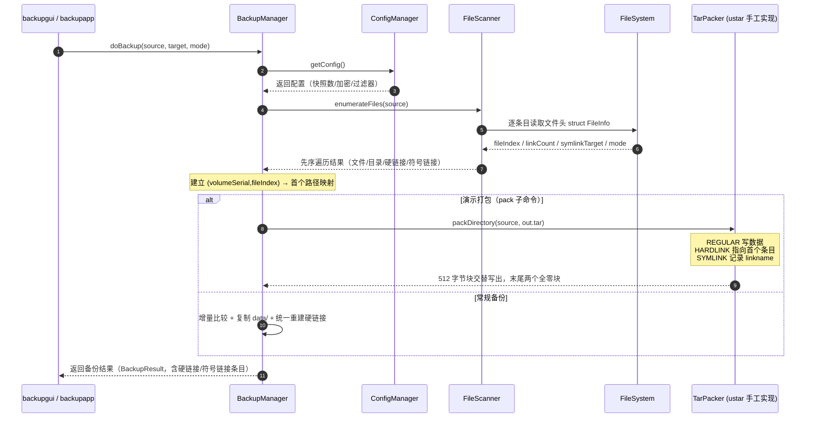

# TAR 打包 / 硬链接 / 软链接 实现说明

对应课程《打包解包》PPT 知识点：Unix 文件系统文件遍历接口、打包接口（TAR），以及
硬链接（inode 共享）与软链接（目录项指向目标路径）的处理。

## 一、文件头：struct FileInfo

遍历接口的每个条目用 `struct` 文件头表示（`include/core/FileInfo.h`），
对应 Unix inode 中与打包/链接相关的字段：

| 字段 | 含义 | Unix 对应 | 来源 |
|------|------|-----------|------|
| `relativePath` | 相对源目录的路径 | 目录项名 | 遍历 |
| `type` | Regular / Directory / Symlink | d_type | `GetFileAttributesW` + reparse 判定 |
| `size` | 文件字节数 | st_size | `GetFileInformationByHandle` |
| `fileIndex` | 文件索引号 | inode 号 | `BY_HANDLE_FILE_INFORMATION.nFileIndexHigh/Low` |
| `volumeSerial` | 卷序列号 | st_dev | 同上的 `dwVolumeSerialNumber` |
| `linkCount` | 链接计数 | st_nlink | 同上的 `nNumberOfLinks` |
| `mode` | 权限（目录 0755 / 文件 0644 简化映射） | st_mode | 按类型推断 |
| `hardLinkTo` | 硬链接组内非首个条目指向首个条目 | — | 备份阶段由 (volume, fileIndex) 映射建立 |
| `symlinkTarget` | 符号链接目标路径 | link 内容 | 读取 reparse buffer |

文件索引 + 卷序列号合起来等价于 Unix 的 `(st_dev, st_ino)`：**同一个 inode 被多个目录项
引用，就是硬链接**。`linkCount > 1` 且 `(volumeSerial, fileIndex)` 相同 ⇔ `ls -li` 里共享
inode 号、链接数为 2 的情形。

## 二、遍历接口：先序遍历

`FileScanner::scan`（`src/engine/FileScanner.cpp`）按**先序遍历**输出目录树：

- 每进入一个目录，先输出目录自身的条目，再递归每个子目录（深度优先、父先于子）；
- 每个目录内的条目按名称排序，保证同一次遍历结果确定；
- 符号链接**不再跳过**：读取目标路径作为 `symlinkTarget` 输出，并发出警告；
  不跟随链接递归，防止成环。

```
scan(root)
  for each entry in sort(list(root))     # 先序：父先于子树
    emit entry
    if entry is directory:
        scan(entry)                      # 递归
```

## 三、打包接口：自实现 ustar TAR（不调库）

`TarPacker`（`include/engine/TarPacker.h`，`src/engine/TarPacker.cpp`）按课程 PPT 的
**HEADER + CONTENT 交替、512 字节块**格式纯手工实现：

```
[512B Header][data 按 512 对齐填充][512B Header][data]... [全零块][全零块]
```

- 头部是 `struct TarHeader`（与 PPT 的 union Record 对齐）：`name[100] mode[8] uid[8]
  gid[8] size[12] mtime[12] check[8] typeflag linkname[100] ustar magic`
  `uname[32] gname[32] devmajor[8] devminor[8] prefix[155]`；
- 数值字段用**八进制 ASCII** 写入；`checksum` 先把字段填空格算出 8 位和，再回填
  （6 位八进制 + NUL + 空格）；
- 路径超过 100 字节时按 `prefix/name` 拆分（> 155 字节则报错）；
- 读/写用二进制 `fstream` 分块流式处理，大文件不整读入内存；
- 文件类型：普通文件 `'0'`、硬链接 `'1'`、符号链接 `'2'`、目录 `'5'`；
- 结尾两个全零 512 块表示归档结束。

### 硬链接的打包

```
a.txt  (fileIndex=100, linkCount=2)  → REGULAR，写入数据
f2.txt (fileIndex=100, linkCount=2)  → HARDLINK，linkname=a.txt，不写数据
```

同一 `(volumeSerial, fileIndex)` 只保存一份数据，其余条目发 `'1'` 硬链接记录。

### 符号链接的打包

```
link.txt (type=Symlink, target=target.txt) → SYMLINK('2')，linkname=target.txt
```

解包时用 `CreateSymbolicLinkW` 重建（需要开发者模式或管理员权限）。

### 解包

按 typeflag 分发：目录 → `createDirectories`；普通文件 → 按 size 写数据块；
硬链接 → 等目标文件写出后 `CreateHardLinkW`（同卷）；符号链接 → `CreateSymbolicLinkW`。

## 四、数据备份顺序图

对应课堂《数据备份》UML 顺序图（GUI → CDataBackup → CConfigManager → CFileEnumerator，
alt 选择打包算法后 pack），本项目的实现如下：



## 五、命令行演示

```powershell
# 打包（自动识别硬链接只存一份、符号链接记录目标）
build\backupapp.exe pack --source D:\MyData --output D:\backup.tar

# 解包（重建硬链接 CreateHardLink、符号链接 CreateSymbolicLink）
build\backupapp.exe unpack --input D:\backup.tar --output E:\Restored
```

## 六、测试

`tests/TarPackerTest.cpp`（5 个用例）：

| 用例 | 验证点 |
|------|--------|
| `RoundTripPreservesFilesAndDirs` | 打包→解包往返，目录/子目录/多块文件内容一致 |
| `HardLinksPreserved` | 同 inode 两目录项打包后解包仍为硬链接（fileIndex 相同） |
| `SymlinkPreserved` | 符号链接打包为 SYMLINK，解包重建且目标正确（需开发者模式，否则跳过） |
| `LargeAndEmptyFiles` | 1MB+17 字节大文件与空文件往返一致 |
| `PreorderTraversalOrder` | 父目录条目先于其子树条目（先序性质） |

> 符号链接用例在本机无开发者模式时按 `GTEST_SKIP` 跳过（错误码 1314）；
> 开启开发者模式或管理员终端后可完整执行。

## 七、用例图

系统整体功能用例图（UML Use Case Diagram）见 `docs/backup-usecase.svg`（可编辑矢量）与
`docs/backup-usecase.html`（浏览器查看，含符号说明与功能覆盖对照表）：

| 参与者 | 关联用例 |
|--------|----------|
| 用户 | 执行备份、恢复数据、校验完整性、查看历史记录、TAR 打包、TAR 解包、注册计划任务 |
| Windows 计划任务 | 执行备份（定时触发） |

| 关系 | 数量 | 说明 |
|------|------|------|
| «include» | 8 | 执行备份 → 扫描目录(先序遍历)/变更检测/复制文件；恢复数据 → 数据校验；TAR 打包 → 硬链接识别/符号链接记录；TAR 解包 → 重建硬链接/重建符号链接 |
| «extend» | 3 | 加密备份/保留快照 → 执行备份；时间点恢复 → 恢复数据 |

UML 符号约定：火柴人=参与者、椭圆=用例、实线=关联、虚线箭头+«include»=包含、
虚线箭头+«extend»=扩展、圆角大矩形=系统边界（见图中图例）。
